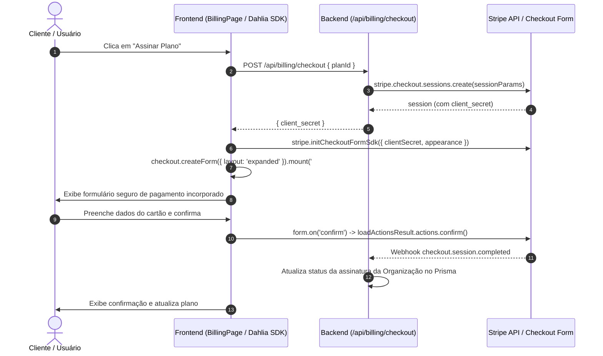

# Stripe Checkout Integration & Setup Guide

This document is your single source of truth for the Stripe Checkout embedded form integration and all remaining configuration steps needed to go live.

---

## Values to Replace

The following values are placeholders and must be updated before going live.

**Files containing placeholders:**
- [server/src/modules/billing/billing.service.ts](server/src/modules/billing/billing.service.ts)
- [server/.env](server/.env)
- [client/.env](client/.env)

| Field | Current Value | What to Set |
|-------|--------------|-------------|
| STRIPE_SECRET_KEY | `sk_test_...` (or empty) | Your Stripe Secret Key from Dashboard: https://dashboard.stripe.com/test/apikeys |
| VITE_STRIPE_PUBLISHABLE_KEY | `pk_test_...` (or empty) | Your Stripe Publishable Key from Dashboard: https://dashboard.stripe.com/test/apikeys |
| STRIPE_WEBHOOK_SECRET | `whsec_...` (or empty) | Webhook signing secret from Dashboard or CLI: https://dashboard.stripe.com/workbench/webhooks |
| line_items[].price | Dynamic inline `price_data` | (Optional) Replace with pre-created Stripe Price IDs (`price_...`) from Dashboard: https://dashboard.stripe.com/prices |

---

## Configured Parameters

These parameters were configured in Checkout Studio and are already set correctly.

**Files containing these parameters:**
- [server/src/modules/billing/billing.service.ts](server/src/modules/billing/billing.service.ts)

| Parameter | Value |
|-----------|-------|
| ui_mode | `"form"` |
| mode | `"subscription"` |
| billing_address_collection | `"auto"` |
| phone_number_collection | `{"enabled": false}` |
| automatic_tax | `{"enabled": false}` |
| payment_method_collection | `"always"` |
| submit_type | `"auto"` |
| integration_identifier | `"custom_embedded_web_0001"` |

---

## Setup and Next Steps

### 1. Environment Variables & API Keys

Configure your environment variables in both the server and client environments:

#### Server (`server/.env`):
```bash
# Server-only keys (NEVER expose to the browser)
STRIPE_SECRET_KEY=sk_test_51...
STRIPE_WEBHOOK_SECRET=whsec_...
```

#### Client (`client/.env`):
```bash
# Browser-accessible keys (must use VITE_ prefix)
VITE_STRIPE_PUBLISHABLE_KEY=pk_test_51...
```

### 2. Project Structure of Modified & Created Files

- `server/src/modules/billing/billing.service.ts` — Updated `stripe.checkout.sessions.create` call with `2026-03-25.dahlia` API version and the authoritative Field Intents (`ui_mode: "form"`, `billing_address_collection: "auto"`, `phone_number_collection: { enabled: false }`, `automatic_tax: { enabled: false }`, `payment_method_collection: "always"`, `submit_type: "auto"`, `integration_identifier: "custom_embedded_web_0001"`), returning `{ client_secret: session.client_secret }`.
- `client/index.html` — Includes `<script src="https://js.stripe.com/dahlia/stripe.js"></script>` directly from Stripe in the `<head>` tag.
- `client/src/pages/BillingPage.tsx` — Integrates `stripe.initCheckoutFormSdk(...)`, mounts the embedded form to `<div id="checkout-form"></div>`, and wires the `confirm` event to `loadActionsResult.actions.confirm`.
- `client/.env.example` — Documented `VITE_STRIPE_PUBLISHABLE_KEY`.
- `STRIPE_INTEGRATION_TODO.md` — Single source of truth for configuration and maintenance.

### 3. How the Integration Works (Flow Overview)



### 4. Testing Credit Card Numbers and Test Modes

When testing in Stripe Test Mode (`pk_test_...` and `sk_test_...`), use the standard test card credentials:

| Card Type | Number | Expiry Date | CVC | Postal Code |
|-----------|--------|-------------|-----|-------------|
| Sucesso Padrão (Visa) | `4242 4242 4242 4242` | Qualquer data futura (ex: `12/34`) | Qualquer 3 dígitos (ex: `123`) | `12345` / `01001-000` |
| Cartão Recusado | `4000 0000 0000 0002` | Qualquer data futura | `123` | `12345` |
| Autenticação 3D Secure | `4000 0000 0000 3063` | Qualquer data futura | `123` | `12345` |

For more test cards (insufficient funds, expired cards, international):
https://docs.stripe.com/testing

### 5. Webhook Configuration for Local Development & Production

To test webhook handling (`checkout.session.completed`, `customer.subscription.deleted`, etc.) locally using the Stripe CLI:

```bash
stripe login
stripe listen --forward-to localhost:3000/api/billing/webhook
```
Copy the webhook signing secret provided in the CLI output (`whsec_...`) into `server/.env` under `STRIPE_WEBHOOK_SECRET`.

### 6. Next Steps

1. **Dashboard Price IDs (Optional):** If you prefer catalog products instead of dynamic line items, create your monthly products in [Stripe Dashboard > Products](https://dashboard.stripe.com/products) and set `price: 'price_...'` in `server/src/modules/billing/billing.service.ts`.
2. **Customer Portal:** Enable the Stripe Customer Portal in your Stripe settings if you want users to manage payment methods and download tax invoices directly.
3. **Production Verification:** Before going live, activate your Stripe account, swap test keys (`sk_test_`, `pk_test_`) for live keys (`sk_live_`, `pk_live_`), and configure your production webhook endpoint in Stripe Dashboard.

### 7. Resources

- Stripe Support: https://support.stripe.com
- Stripe Developer Documentation: https://docs.stripe.com
- Stripe Model Context Protocol (MCP): https://docs.stripe.com/mcp
