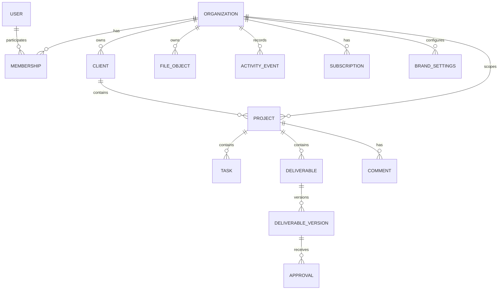

# DEVELOPMENT PROMPT — SaaS Freemium Universal de Portal de Clientes para Agências

> **Papel deste documento:** especificação principal e prompt operacional para uma IA de programação implementar o produto descrito abaixo em um repositório real.  
> **Objetivo:** construir um SaaS funcional, seguro, testável e preparado para lançamento gradual — não apenas um protótipo visual.  
> **Idioma do produto:** preparar a arquitetura para internacionalização; o idioma inicial da interface pode ser definido pelo projeto existente.  
> **Regra de prioridade:** inspecione primeiro o repositório e preserve decisões existentes que sejam adequadas. Onde não houver decisões, siga as recomendações deste documento e registre as hipóteses.

---

## Índice

1. [Instruções operacionais para a IA](#1-instruções-operacionais-para-a-ia)
2. [Visão do produto](#2-visão-do-produto)
3. [Princípios e limites do produto](#3-princípios-e-limites-do-produto)
4. [Públicos, papéis e permissões](#4-públicos-papéis-e-permissões)
5. [Modelo freemium e regras comerciais](#5-modelo-freemium-e-regras-comerciais)
6. [Escopo do MVP](#6-escopo-do-mvp)
7. [Requisitos funcionais](#7-requisitos-funcionais)
8. [Experiência do usuário e design system](#8-experiência-do-usuário-e-design-system)
9. [Arquitetura técnica](#9-arquitetura-técnica)
10. [Modelo de dados](#10-modelo-de-dados)
11. [Segurança, privacidade e isolamento multi-tenant](#11-segurança-privacidade-e-isolamento-multi-tenant)
12. [API e contratos](#12-api-e-contratos)
13. [Planos, pagamentos e assinaturas](#13-planos-pagamentos-e-assinaturas)
14. [Arquivos e armazenamento](#14-arquivos-e-armazenamento)
15. [Notificações e tarefas assíncronas](#15-notificações-e-tarefas-assíncronas)
16. [Administração, métricas e suporte](#16-administração-métricas-e-suporte)
17. [Testes e qualidade](#17-testes-e-qualidade)
18. [Observabilidade, deploy e operação](#18-observabilidade-deploy-e-operação)
19. [Fases de implementação](#19-fases-de-implementação)
20. [Critérios globais de aceitação](#20-critérios-globais-de-aceitação)
21. [Checklist de lançamento](#21-checklist-de-lançamento)
22. [Definição de pronto](#22-definição-de-pronto)

---

## 1. Instruções operacionais para a IA

Você é responsável por atuar como arquiteto de software, engenheiro full-stack, especialista em segurança de aplicações, designer de produto e responsável pela qualidade da implementação.

### 1.1 Antes de alterar o projeto

1. Inspecione o repositório, os arquivos de configuração, o package manager, a estrutura de pastas, as dependências, as migrações, os testes e a documentação.
2. Identifique o que já funciona e quais decisões técnicas já foram tomadas.
3. Não substitua a stack, não apague funcionalidades e não reescreva arquivos extensos sem compreender sua finalidade.
4. Apresente um plano curto de implementação, dependências, riscos e critérios de validação antes de uma mudança arquitetural relevante.
5. Se o repositório estiver vazio, proponha uma arquitetura simples e coerente usando as recomendações deste documento.
6. Não invente credenciais, chaves, endpoints, domínios, configurações de produção nem resultados de testes.

### 1.2 Como trabalhar

- Implemente em etapas pequenas, funcionais e verificáveis.
- Prefira fluxos completos de ponta a ponta a muitas telas desconectadas.
- Cada funcionalidade que dependa de persistência deve possuir modelo de dados, validação, autorização no servidor, tratamento de erro, interface e testes apropriados.
- Não use dados fictícios permanentes como substituto de uma integração real. Dados de demonstração são permitidos somente em seeds, fixtures ou modo de demonstração explicitamente identificado.
- Não simule sucesso de operações que falharam no backend.
- Não deixe botões sem ação, links quebrados, formulários decorativos ou telas que dependam de dados impossíveis de criar.
- Não implemente integrações pagas ou externas sem documentar variáveis de ambiente, configuração, custos potenciais e modo de teste.
- Não introduza microserviços, filas, cache ou abstrações complexas sem necessidade demonstrável.
- Mantenha o código tipado, modular, legível e consistente com o padrão do projeto.
- Atualize documentação, migrações e testes quando uma alteração exigir isso.
- Não execute refatorações sem relação com a tarefa atual.
- Nunca exponha segredos em código de cliente, logs, commits, screenshots ou documentação.
- Se faltar uma decisão não crítica, registre uma hipótese razoável e prossiga. Pergunte ao responsável somente quando a ambiguidade impedir o trabalho, afetar segurança/dados ou produzir uma decisão cara de reverter.

### 1.3 Evidências de conclusão

Uma fase só pode ser declarada concluída quando:
- os critérios de aceitação daquela fase foram verificados;
- testes relevantes foram executados;
- lint e verificação de tipos foram executados, quando disponíveis;
- erros introduzidos foram corrigidos;
- limitações restantes foram explicitamente documentadas.

Ao finalizar cada fase, informe: o que foi implementado, arquivos ou módulos relevantes, comandos de teste executados e resultados reais, variáveis/configurações pendentes, riscos e próximo passo. Não afirme que um teste passou se ele não foi executado.

---

## 2. Visão do produto

Construa um SaaS freemium de portal de clientes para agências de marketing, agências criativas, freelancers e empresas prestadoras de serviços digitais.

O produto centraliza o relacionamento operacional entre prestador e cliente: organizações, clientes, projetos, tarefas, entregáveis, arquivos, comentários, solicitações de alteração, aprovações, notificações e histórico.

Públicos iniciais:
- agências de marketing digital e social media;
- agências de tráfego pago, SEO e conteúdo;
- agências de branding, design e produção audiovisual;
- agências de e-mail marketing e marketing de influência;
- consultores, freelancers e pequenas empresas de serviços digitais;
- agências integradas que combinam várias especialidades.

O produto deverá poder ser comercializado internacionalmente, inicialmente com foco nos Estados Unidos e na Europa, sem impedir o uso no Brasil.

### 2.1 Proposta de valor

Permitir que uma agência ofereça um ambiente profissional e, conforme o plano, personalizado com sua marca, no qual cada cliente possa acompanhar projetos, consultar entregáveis, enviar feedback e aprovar materiais.

A plataforma deve reduzir a fragmentação de conversas, e-mails, links e arquivos. O foco é a relação entre a agência e seus clientes, não ser um CRM genérico, uma ferramenta completa de gestão de anúncios ou um gerenciador de tarefas empresarial.

### 2.2 Resultado essencial do MVP

Uma agência deve conseguir criar uma conta, configurar sua organização, cadastrar um cliente, abrir um projeto, publicar um entregável, convidar o cliente, receber comentário ou pedido de alteração, registrar uma aprovação e consultar o histórico dessas ações.

---

## 3. Princípios e limites do produto

### 3.1 Núcleo universal obrigatório

**Implemente um único núcleo de negócio para todas as especialidades.** Não crie sistemas ou tabelas fundamentais separados para social media, tráfego pago, SEO, branding, design ou audiovisual.

O núcleo deve trabalhar com conceitos genéricos:
- organização;
- membro e convite;
- cliente;
- projeto;
- tarefa;
- entregável e versão;
- arquivo;
- comentário;
- solicitação de alteração;
- aprovação;
- notificação;
- modelo;
- categoria;
- evento de auditoria;
- plano, assinatura e limites;
- configuração de marca e domínio.

As diferenças de especialidade devem ser configuradas por modelos, categorias, tipos de entregável, tarefas iniciais e campos configuráveis limitados. Evite um construtor de fluxos excessivamente complexo no MVP.

Exemplos de modelos iniciais:
- social media: calendário, posts, legendas e aprovações;
- tráfego pago: campanha, criativos e relatórios;
- SEO: auditoria, pauta, artigo e relatório;
- branding: conceito, apresentação e revisões;
- audiovisual: roteiro, arquivos de vídeo, versões e aprovação;
- marketing integrado: combinação dos itens anteriores.

Todos esses exemplos devem usar as mesmas entidades e fluxos universais.

### 3.2 Princípios de produto

- Simplicidade operacional para equipes pequenas.
- Experiência de cliente intuitiva, inclusive para quem entra raramente.
- Interface responsiva e acessível.
- Segurança e isolamento de dados como requisitos estruturais.
- Custos baixos e arquitetura proporcional ao estágio inicial.
- Limites comerciais configuráveis, não espalhados pelo código.
- Dados preservados quando o plano é reduzido ou um limite é atingido.
- Nenhuma dependência de integrações de redes sociais ou plataformas de anúncios para o MVP.
- Não prometer conformidade legal automática por meio de recursos técnicos.

### 3.3 Classificação dos requisitos

Use estas classificações no planejamento:
- **Obrigatório:** requisito necessário para o MVP ou segurança.
- **Recomendado:** solução preferida, salvo incompatibilidade com o projeto existente.
- **Posterior:** pode ser adiado sem impedir o fluxo principal.
- **Hipótese:** decisão inicial a validar durante implementação ou operação.

---

## 4. Públicos, papéis e permissões

Separe a identidade global do usuário da associação do usuário a uma organização. Um usuário poderá, se a arquitetura permitir sem complexidade excessiva, participar de mais de uma organização.

### 4.1 Papéis

| Papel | Escopo | Permissões principais |
|---|---|---|
| Proprietário | Organização | Controle total, cobrança, gestão de membros e transferência de propriedade, quando implementada |
| Administrador | Organização | Gerir clientes, projetos, membros e configurações, exceto ações exclusivas do proprietário |
| Membro da equipe | Organização | Trabalhar nos clientes/projetos aos quais tem acesso conforme política definida |
| Cliente convidado | Clientes/projetos explicitamente vinculados | Consultar recursos permitidos, comentar, pedir alterações e aprovar entregáveis |
| Administrador da plataforma | Plataforma | Operações de suporte estritamente controladas, auditadas e sem acesso indiscriminado ao conteúdo privado |

### 4.2 Regras obrigatórias

- Autenticação não equivale a autorização.
- O backend deve verificar identidade, associação à organização, papel e acesso ao recurso em toda operação protegida.
- Clientes convidados nunca podem acessar telas internas de equipe, dados de cobrança ou outros clientes.
- Um membro não deve ganhar acesso a todos os projetos por conhecer ou alterar um ID.
- Convites devem ser de uso controlado, ter expiração e não permitir reutilização indevida.
- A remoção de um membro deve revogar seu acesso aos recursos da organização sem apagar indevidamente o histórico de autoria.
- Operações administrativas privilegiadas devem gerar registro de auditoria.
- A política de acesso a projetos deve ser consistente e documentada: no MVP, membros da equipe podem acessar os recursos da organização conforme seu papel; clientes só acessam os clientes/projetos explicitamente associados.

---

## 5. Modelo freemium e regras comerciais

Use inicialmente os valores abaixo como hipóteses comerciais. Mantenha preços e limites em configuração centralizada e editável, sem exigir alteração de código de negócio para um ajuste comum.

| Plano | Preço mensal de referência | Limite inicial de clientes ativos |
|---|---:|---:|
| Free | US$ 0 | 2 |
| Pro | US$ 10 | 10 |
| Business | US$ 20 | 30 |
| Agency | US$ 40 | 100 |

Esses valores são hipóteses a validar, não uma garantia de rentabilidade. Não codifique preços diretamente em componentes de interface ou em verificações espalhadas pelo backend.

### 5.1 Matriz inicial de recursos

| Recurso | Free | Pro | Business | Agency |
|---|---|---|---|---|
| Clientes ativos | 2 | 10 | 30 | 100 |
| Projetos ativos | 3 | Limite configurável superior | Limite configurável superior | Limite configurável superior |
| Portal do cliente | Básico | Sim | Sim | Sim |
| Comentários e aprovações | Básicos | Aprimorados | Aprimorados | Aprimorados |
| Armazenamento | Baixo limite configurável | Maior | Maior | Maior |
| Logotipo e cores | Não ou básico | Básico | Avançado | Avançado |
| Marca do SaaS removida | Não | Não, salvo configuração comercial | Sim | Sim |
| Domínio personalizado | Não | Não | Sim | Sim |
| Modelos reutilizáveis | Básicos | Sim | Sim | Sim |
| Membros de equipe | Proprietário e limite mínimo | Configurável | Configurável | Múltiplos |
| Permissões avançadas | Não | Básicas | Básicas | Sim |
| Automações | Não ou limitadas | Básicas | Básicas | Avançadas |
| Relatórios operacionais | Básicos | Básicos | Sim | Avançados |

A IA deve transformar valores ainda indefinidos — como armazenamento, número de membros e projetos — em configurações explícitas, com defaults conservadores e documentação. Não anunciar recursos pagos como disponíveis se a implementação ou integração necessária não existir.

### 5.2 Entitlement e limites

Crie uma camada central de plano/entitlements para decidir:
- quantidade máxima de clientes ativos;
- projetos ativos;
- armazenamento utilizado;
- número de membros;
- domínio personalizado;
- modelos, automações e relatórios;
- outros recursos cobrados no futuro.

Regras:
1. Validar limites no backend, inclusive em operações concorrentes.
2. A interface pode antecipar o bloqueio, mas não é a fonte de autoridade.
3. Arquivar um cliente deve liberar a vaga conforme a regra comercial.
4. Ao atingir limite, explicar qual limite foi atingido e oferecer ação apropriada, como arquivar um item ou comparar planos.
5. Não apagar dados nem bloquear leitura dos recursos existentes apenas por downgrade ou excesso de uso.
6. Em downgrade, manter os dados e impedir somente novas operações incompatíveis, após comunicação clara.
7. Evitar condições de corrida na criação simultânea de recursos; usar transação, restrição ou mecanismo equivalente.
8. Não contar clientes arquivados como ativos, salvo decisão comercial documentada.
9. Medir conversão sem confundir usuário, organização, cliente final e conta pagante.

### 5.3 Estados de assinatura

Modele separadamente o estado informado pelo provedor e o estado efetivo de acesso ao produto. Defina comportamento para:
- gratuita;
- checkout iniciado;
- ativa;
- pagamento pendente;
- falha de pagamento;
- em período de tolerância, se adotado;
- cancelamento agendado;
- cancelada;
- expirada;
- reembolso ou disputa, conforme suporte do provedor.

A conta Free deve continuar utilizável sem cartão. Cancelar um plano pago não deve apagar dados. A política para inadimplência deve ser clara, previsível e implementada no servidor.

---

## 6. Escopo do MVP

### 6.1 Obrigatório para lançamento inicial

- Cadastro, login, logout, recuperação e verificação de e-mail, conforme suporte da stack.
- Criação da organização e onboarding curto.
- Gestão de clientes e convites.
- Gestão de projetos.
- Tarefas simples e status.
- Entregáveis com versões.
- Comentários e pedidos de alteração.
- Fluxo de aprovação por versão.
- Upload seguro e acesso privado a arquivos.
- Portal do cliente.
- Notificações essenciais, inicialmente por e-mail quando configuradas.
- Limites do plano Free aplicados no backend.
- Papéis e autorização multi-tenant.
- Página de configurações básicas.
- Estados de carregamento, erro, vazio e sucesso.
- Testes dos fluxos principais e de acesso cruzado.
- Documentação de instalação e configuração.
- Deploy reproduzível.

### 6.2 Importante, mas pode ser posterior

- Checkout e cobrança recorrente em produção, se a conta do provedor ainda não estiver disponível. A integração deve ter contratos e modo de teste, sem fingir que há cobrança real.
- Relatórios avançados.
- Automações configuráveis.
- Modelos avançados.
- Administração interna completa.
- Exportação e exclusão self-service avançadas, além do mínimo de privacidade necessário.

### 6.3 Fora do MVP

- Publicação automática em redes sociais.
- Integrações profundas com Google Ads, Meta Ads ou ferramentas de SEO.
- CRM de vendas completo.
- Contabilidade, faturamento empresarial completo ou folha de pagamento.
- Editor de vídeo/design embutido.
- Chat em tempo real genérico.
- Construtor de workflows arbitrários.
- Microserviços e infraestrutura distribuída sem necessidade comprovada.

---

## 7. Requisitos funcionais

### 7.1 Autenticação e onboarding

Implemente:
- cadastro e login;
- logout e revogação de sessão;
- recuperação de senha com token seguro, expiração e uso único;
- verificação de e-mail quando suportada;
- gerenciamento de perfil;
- criação da organização;
- configuração inicial de nome, especialidades e identidade visual básica;
- criação do primeiro cliente e projeto;
- convite do primeiro cliente.

O onboarding deve conduzir o usuário até um resultado útil rapidamente. Permita concluir configurações secundárias depois. Não exiba passos concluídos antes de confirmar persistência no servidor.

Critérios de aceitação:
- erros de validação são apresentados de forma compreensível;
- senha e tokens não aparecem em logs;
- tokens expirados ou usados não funcionam;
- o usuário autenticado não consegue assumir a identidade de outro usuário alterando parâmetros;
- o fluxo funciona em viewport móvel e desktop.

### 7.2 Organizações e equipes

Uma organização representa uma agência. Implemente nome, slug ou identificador seguro, estado, plano, preferências, marca e datas de auditoria.

Gerencie:
- proprietário;
- administradores;
- membros;
- convites pendentes, aceitos, expirados e revogados;
- entrada e remoção de membros;
- transferência de propriedade somente se o fluxo for seguro e auditado;
- associação dos recursos à organização.

Critérios:
- um convite expirado não pode ser aceito;
- o mesmo convite não pode ser consumido de forma concorrente duas vezes;
- usuários não autorizados não podem convidar membros ou modificar papéis;
- remover um membro revoga acesso em requisições subsequentes.

### 7.3 Clientes

Cada cliente deve conter, no mínimo:
- identificador;
- organização proprietária;
- nome de exibição;
- e-mail de contato opcional;
- empresa ou observações opcionais, quando justificadas;
- estado ativo/arquivado;
- criador;
- datas de criação e atualização.

Implemente criar, visualizar, editar, arquivar, reativar, pesquisar, filtrar e paginar. Não use exclusão física como ação padrão. Diferencie cliente cadastrado de usuário convidado: o cliente pode existir antes de ter acesso ao portal.

Critérios:
- clientes arquivados não aparecem por padrão na lista de ativos;
- arquivamento não remove projetos ou histórico;
- o limite de clientes ativos é validado no servidor;
- nenhum cliente de outra organização pode ser consultado ou modificado.

### 7.4 Projetos

Cada projeto deve conter:
- nome e descrição;
- organização e cliente;
- status;
- responsáveis internos opcionais;
- data de início e prazo opcional;
- categoria ou tipo;
- modelo de origem opcional;
- datas de criação e atualização;
- estado de arquivamento.

Status iniciais recomendados: `draft`, `active`, `on_hold`, `completed`, `archived`. Use enum ou tabela de referência conforme convenções da stack, com mapeamento claro para rótulos da interface.

Permita visualizar detalhes, tarefas, entregáveis, arquivos, comentários e histórico em uma única página de projeto. Não crie entidades separadas para cada especialidade.

Critérios:
- cliente associado precisa pertencer à mesma organização;
- alterações de status são validadas no backend;
- projetos concluídos e arquivados continuam consultáveis conforme permissões;
- a interface comunica prazo vencido sem depender exclusivamente de cor.

### 7.5 Tarefas e solicitações

Tarefas devem incluir título, descrição opcional, status, prioridade simples, responsável opcional, prazo opcional, projeto, criador e timestamps.

Status recomendados: `todo`, `in_progress`, `blocked`, `done`. A solicitação de alteração do cliente pode ser representada por uma entidade específica ou por um tipo de tarefa, desde que seja possível distinguir origem, estado e histórico de forma inequívoca. Escolha a opção mais simples que preserve rastreabilidade.

No MVP, não implementar dependências complexas, gráficos de Gantt ou gestão empresarial de recursos.

Critérios:
- tarefa pertence a um projeto válido;
- responsável pertence à organização e tem permissão;
- o cliente só vê tarefas que a política do produto permite compartilhar;
- comentários e mudanças relevantes aparecem no histórico.

### 7.6 Entregáveis, versões e aprovações

Entregáveis são centrais ao produto. Devem suportar arquivos e links externos e tipos genéricos, como imagem, vídeo, documento, apresentação, texto, legenda, relatório, criativo, material de branding ou pré-visualização externa.

Cada entregável deve possuir:
- título e descrição;
- projeto relacionado;
- tipo;
- responsável;
- status;
- uma ou mais versões;
- data de envio para revisão;
- comentários relacionados;
- histórico de eventos.

Estados recomendados:
- `draft`: ainda não enviado ao cliente;
- `in_review`: versão enviada para revisão;
- `changes_requested`: cliente pediu alterações;
- `approved`: versão atual aprovada;
- `archived`: arquivado.

Defina transições permitidas. Exemplo:
- rascunho → revisão;
- revisão → aprovado;
- revisão → alterações solicitadas;
- alterações solicitadas → nova versão em revisão;
- estados terminais ou arquivamento conforme política explícita.

**Regra de versão:** uma aprovação sempre deve apontar para uma versão específica. Ao enviar uma nova versão, não herde automaticamente a aprovação anterior. A versão aprovada anteriormente permanece no histórico, mas a nova versão volta para revisão.

Registre autor, timestamp, versão, ação e comentário opcional em cada aprovação ou pedido de alteração. Clientes convidados só podem aprovar entregáveis visíveis a eles e vinculados a clientes/projetos aos quais tenham acesso.

Critérios:
- não é possível aprovar um rascunho que não foi enviado;
- a ação de aprovação registra a versão exata;
- atualizar um entregável não altera retroativamente o histórico;
- requisições duplicadas não geram aprovações duplicadas;
- a interface distingue claramente versão atual, aprovada e pendente.

### 7.7 Arquivos e anexos

Suporte upload e download de arquivos privados, com limites de tamanho e tipos configuráveis. Não armazene arquivos grandes no banco relacional sem justificativa técnica.

Requisitos:
- validar tamanho e tipo no servidor;
- validar extensão e MIME, sem confiar apenas no nome enviado;
- gerar nomes internos não previsíveis;
- armazenar metadados e referência ao objeto;
- servir arquivos mediante autorização e URLs assinadas de curta duração ou mecanismo equivalente;
- impedir acesso cruzado entre organizações;
- definir política de exclusão, retenção e backup;
- contabilizar uso de armazenamento por organização;
- evitar URLs públicas permanentes para conteúdo privado.

No MVP, documente os provedores necessários e ofereça um adaptador para o armazenamento escolhido. Não declare upload em produção funcional se a configuração externa não estiver disponível.

### 7.8 Comentários e comunicação

Comentários devem ser ligados a um recurso, como projeto ou entregável, e conter autor, texto, timestamps e estado de edição/exclusão, conforme política definida.

Não construa um chat genérico. O objetivo é manter feedback contextual e histórico.

Requisitos:
- verificar se o autor tem acesso ao recurso;
- escapar ou sanitizar conteúdo conforme a forma de renderização;
- preservar contexto de auditoria quando comentários forem editados ou removidos;
- notificar os participantes relevantes sem criar ciclos de notificações;
- indicar claramente a autoria e o horário.

### 7.9 Portal do cliente

O portal deve ser uma experiência simplificada e responsiva, adequada a usuários que não utilizam o produto diariamente.

O cliente pode:
- acessar somente os clientes/projetos explicitamente associados;
- consultar status, prazos e pendências compartilhadas;
- visualizar entregáveis e versões autorizadas;
- abrir arquivos com acesso protegido;
- comentar;
- solicitar alterações;
- aprovar uma versão;
- gerenciar preferências básicas de notificação.

O cliente não pode:
- consultar dados de cobrança da agência;
- gerenciar membros internos;
- acessar outros clientes;
- ver notas internas explicitamente marcadas como internas;
- alterar permissões ou limites comerciais.

Não misture comentários internos e comentários visíveis ao cliente sem um campo e uma política de autorização inequívocos.

### 7.10 Notificações

Eventos iniciais:
- convite enviado ou aceito;
- projeto criado ou status alterado;
- entregável enviado para revisão;
- alteração solicitada;
- entregável aprovado;
- comentário recebido;
- tarefa próxima do prazo, se a tarefa assíncrona estiver configurada.

Implemente preferências simples por usuário e tipo de evento quando viável. Evite excesso de mensagens, duplicações e notificações que retornem ao autor da própria ação sem necessidade.

Se usar processamento assíncrono, trate repetição de jobs e falhas. Se a fila não estiver configurada no MVP, use uma estratégia simples e documentada, sem simular envio de e-mail bem-sucedido.

### 7.11 Modelos universais

Modelos podem definir título, descrição inicial, categoria, tarefas iniciais, tipos de entregáveis e instruções. Permita criar projeto a partir de modelo e manter cópia dos valores no novo projeto, para que editar o modelo não altere projetos já criados.

Forneça modelos de exemplo para social media, tráfego pago, SEO, branding, conteúdo, audiovisual e marketing integrado, mas todos devem usar o mesmo mecanismo de dados.

### 7.13 Busca, filtros e paginação

Listas de clientes, projetos, tarefas e entregáveis devem oferecer busca ou filtros adequados, paginação quando necessário e estados vazios úteis. A busca deve respeitar o escopo da organização e as permissões do usuário. Não carregue todos os registros indiscriminadamente para filtrar apenas no navegador.

---

## 8. Experiência do usuário e design system

A interface deve parecer um SaaS comercial maduro: minimalista, moderna, consistente e confiável. Evite aparência de template genérico ou dashboard cheio de cartões sem hierarquia.

### 8.1 Princípios visuais

- Hierarquia visual clara e densidade controlada.
- Tipografia legível e escala consistente.
- Espaçamento e alinhamento sistemáticos.
- Navegação previsível.
- Componentes reutilizáveis.
- Feedback visual imediato para ações.
- Contraste acessível.
- Responsividade real, não apenas redução de largura.
- Estados de carregamento, vazio, erro, sucesso e ausência de permissão.
- Confirmação de ações destrutivas.
- Formulários com rótulos, ajuda e mensagens de erro.
- Não comunicar status somente por cor.
- Evitar animações excessivas que prejudiquem produtividade ou acessibilidade.

### 8.2 Tokens e componentes

Crie tokens para cores, tipografia, espaçamento, bordas, sombras, raios, foco, camadas e breakpoints. Prefira variáveis/tokens centralizados em vez de valores arbitrários repetidos.

Implemente componentes reutilizáveis para:
- botões e links;
- campos, selects, checkboxes e formulários;
- modais e diálogos de confirmação;
- menus e navegação;
- badges de status;
- tabelas/listas;
- cards de projeto e entregável;
- avatar e identidade de organização;
- notificações/toasts;
- skeletons;
- estados vazios;
- paginação;
- visualização de arquivo e versão;
- confirmação de aprovação.

Use os componentes e padrões já existentes se forem adequados. Não introduza uma biblioteca visual nova sem avaliar o que já está instalado.

### 8.3 Páginas mínimas

Públicas:
- apresentação/landing page;
- preços;
- cadastro;
- login;
- recuperação de senha;
- termos e privacidade, quando fornecidos pelo responsável.

Aplicação da agência:
- onboarding;
- dashboard;
- clientes e detalhe do cliente;
- projetos e detalhe do projeto;
- tarefas;
- entregáveis e visualização de aprovação;
- arquivos;
- notificações;
- configurações da organização;
- equipe e permissões;
- marca;
- plano e assinatura;
- estados de erro e acesso negado.

Portal do cliente:
- entrada/aceitação de convite;
- visão geral;
- projetos acessíveis;
- detalhes do projeto;
- entregáveis, versões, comentários e aprovação;
- arquivos autorizados;
- preferências básicas.

Administração interna:
- somente se necessária ao funcionamento do MVP; deve ficar isolada da aplicação comum, protegida por autorização forte e auditada.

### 8.4 Estados de interface

Cada página deve tratar:
- carregamento inicial;
- carregamento de ação;
- erro recuperável;
- erro não recuperável;
- lista vazia;
- ausência de resultados de busca;
- acesso negado;
- sessão expirada;
- limite do plano atingido;
- sucesso e confirmação de persistência.

Nunca mostrar mensagem de sucesso antes de a operação ter sido confirmada pelo backend. Evite substituir silenciosamente dados de formulário após erro.

### 8.5 Acessibilidade

Busque conformidade prática com WCAG 2.2 AA nos fluxos principais:
- navegação por teclado;
- foco visível;
- rótulos acessíveis;
- semântica adequada;
- contraste;
- mensagens de erro associadas aos campos;
- modais com foco controlado;
- respeito a `prefers-reduced-motion`;
- textos alternativos para imagens relevantes.

Não afirme conformidade certificada sem auditoria apropriada.

---

## 9. Arquitetura técnica

### 9.1 Regra de escolha da stack

Primeiro, inspecione o projeto. Preserve a stack existente se for adequada, segura e sustentável. Se o repositório estiver vazio ou não houver escolha anterior, prefira uma arquitetura simples, tipada e bem documentada.

Base de frontend esperada:
- React;
- TypeScript;
- Tailwind CSS.

Para backend, API, banco, autenticação, armazenamento, e-mail e pagamento, selecione tecnologias compatíveis com o projeto e com a capacidade operacional disponível. Registre a decisão e seus trade-offs. Não presuma que qualquer serviço já está contratado.

### 9.2 Arquitetura recomendada

Comece com um **monólito modular** ou uma aplicação full-stack bem separada por módulos. Evite microserviços prematuros.

Módulos de domínio sugeridos:
- `auth`;
- `organizations`;
- `memberships`;
- `clients`;
- `projects`;
- `tasks`;
- `deliverables`;
- `files`;
- `comments`;
- `approvals`;
- `notifications`;
- `billing`;
- `branding`;
- `audit`;
- `admin` (se necessário).

Cada módulo deve separar, de acordo com o padrão da stack:
- validação de entrada;
- regras de negócio;
- acesso a dados;
- handlers/controllers;
- autorização;
- testes.

Não crie camadas artificiais sem benefício. Evite duplicar regras entre frontend e backend; a validação de interface melhora UX, mas as regras de autoridade pertencem ao servidor.

### 9.3 Banco de dados

Use banco relacional quando não houver uma razão concreta para outra abordagem. Defina migrações versionadas, chaves estrangeiras, índices e restrições de integridade. Não edite o banco de produção manualmente como substituto de migrações.

Requisitos:
- IDs não previsíveis ou exposição segura de IDs, sem depender disso como autorização;
- timestamps consistentes, armazenados em UTC;
- transações para operações que alterem vários registros;
- índices para chaves estrangeiras, organização, status e campos de consulta frequente;
- exclusão lógica quando necessária para preservar histórico;
- política explícita de exclusão física e retenção;
- nenhuma consulta multi-tenant sem escopo e autorização.

### 9.4 API e validação

Escolha REST ou outro estilo coerente com a stack; documente os contratos. Valide todos os dados recebidos no servidor. Normalize erros em formato consistente, sem retornar stack traces ou segredos ao cliente.

Para cada endpoint/ação, defina:
- autenticação necessária;
- papel/permissão necessária;
- validação de entrada;
- recurso e escopo organizacional;
- códigos/estados de resposta;
- comportamento em falhas;
- testes de autorização e validação.

### 9.5 Configuração e segredos

- Forneça `.env.example` sem segredos reais.
- Valide variáveis de ambiente no início da aplicação.
- Diferencie configuração pública e privada.
- Nunca exponha chaves privadas no bundle frontend.
- Não registre tokens, senhas, conteúdo sensível ou URLs assinadas em logs.
- Documente como criar e rotacionar segredos.
- Use configurações distintas para desenvolvimento, testes e produção.

### 9.6 Escalabilidade proporcional

No início, prefira consultas eficientes, paginação, índices, armazenamento externo para arquivos e logs estruturados. Adicione cache, filas ou workers quando houver necessidade medida ou uma exigência clara, não por antecipação. Documente limites conhecidos e pontos de evolução.

---

## 10. Modelo de dados

Adapte nomes e tipos ao ORM e ao banco escolhidos. Esta é uma proposta conceitual, não uma exigência de nomes literais.

### 10.1 Entidades centrais

| Entidade | Campos/conceitos principais | Observações |
|---|---|---|
| `User` | id, nome, e-mail normalizado, credenciais/provedor, estado, timestamps | Identidade global; nunca guardar senha em texto puro |
| `Organization` | id, nome, slug, owner_id, plano/estado, configurações, timestamps | Tenant principal |
| `Membership` | id, organization_id, user_id, role, estado, timestamps | Relação de usuário com organização |
| `Invitation` | id, organization_id, e-mail, role, token_hash, expires_at, accepted_at, created_by | Token armazenado como hash quando aplicável |
| `Client` | id, organization_id, nome, e-mail de contato, status, created_by, timestamps | Cliente de negócio; não precisa ser usuário |
| `ClientAccess` | id, organization_id, client_id, user_id ou vínculo de convite, estado | Associação explícita do usuário convidado ao cliente |
| `Project` | id, organization_id, client_id, nome, descrição, status, datas, categoria, created_by | Cliente e projeto devem compartilhar o mesmo tenant |
| `ProjectMember` | project_id, membership_id, papel/escopo opcional | Apenas se acesso por projeto for necessário |
| `Task` | id, organization_id, project_id, título, descrição, status, prioridade, responsável, prazo | Tarefa universal |
| `Deliverable` | id, organization_id, project_id, título, descrição, tipo, status, responsável | Agrega versões e estado atual |
| `DeliverableVersion` | id, organization_id, deliverable_id, version_number, file_id ou external_url, nota, created_by, created_at | Imutável após envio, salvo política documentada |
| `Approval` | id, organization_id, deliverable_id, version_id, actor_id, decision, comment, created_at | Sempre associada à versão exata |
| `FileObject` | id, organization_id, storage_key, nome original, MIME validado, tamanho, checksum, uploaded_by, timestamps | O conteúdo binário fica no storage |
| `Comment` | id, organization_id, resource_type, resource_id, author_id, body, visibility, timestamps | Definir com cuidado os recursos permitidos e integridade referencial |
| `ActivityEvent` | id, organization_id, actor_id, resource_type, resource_id, event_type, metadata mínima, created_at | Evitar armazenar segredos ou excesso de dados pessoais |
| `Notification` | id, user_id, organization_id, type, payload mínimo, read_at, created_at | Respeitar escopo e preferências |
| `NotificationPreference` | user_id, event_type, in_app_enabled, email_enabled | Defaults documentados |
| `ProjectTemplate` | id, organization_id ou global, nome, categoria, descrição, configuração | Modelos globais e próprios, se ambos existirem |
| `Subscription` | id, organization_id, provider, provider_customer_id, provider_subscription_id, status, period_end, timestamps | Não armazenar dados de cartão |
| `Plan` | id/key, nome, preço, moeda, estado | Fonte comercial centralizada |
| `PlanEntitlement` | plan_id, key, value | Limites e recursos configuráveis |
| `UsageCounter` ou cálculo de uso | organization_id, metric_key, value, period | Escolher cache/contagem apenas se necessário; manter consistência |
| `BrandSettings` | organization_id, logo_file_id, cores, nome exibido, hide_vendor_brand | Validar valores e acesso |
| `CustomDomain` | organization_id, hostname, verification_status, verification_token_hash, verified_at | Não marcar ativo antes de verificação e roteamento |
| `AuditLog` | actor_id, organization_id opcional, action, target, metadata mínima, created_at | Protegido contra alterações não autorizadas |

### 10.2 Regras de integridade

- Recursos de negócio devem conter `organization_id` ou ter um caminho de relacionamento inequívoco e validado até a organização.
- IDs estrangeiros recebidos do cliente devem ser validados no contexto do tenant atual.
- Ao associar um projeto a um cliente, confirme que ambos pertencem à mesma organização.
- Ao associar um arquivo, confirme organização, proprietário lógico e autorização de leitura.
- Use chaves únicas para e-mail normalizado ou slug quando apropriado.
- Use restrições e transações para evitar estados inconsistentes.
- Defina `ON DELETE` conscientemente; não propague exclusões em cascata sobre dados históricos sem justificativa.
- Não use campos JSON para substituir relações centrais que precisam de integridade, pesquisa ou autorização. JSON pode ser usado para configurações limitadas e versionadas.

### 10.3 Diagrama conceitual

O diagrama é conceitual. Ajuste entidades e relações para que a integridade referencial e a autorização possam ser efetivamente aplicadas na tecnologia escolhida.

---

## 11. Segurança, privacidade e isolamento multi-tenant

Segurança não é uma etapa final. Implemente-a desde os primeiros modelos e endpoints.

### 11.1 Isolamento de tenant

- Determine a organização ativa a partir de uma associação autenticada e autorizada, não de um `organization_id` arbitrário fornecido pelo cliente sem verificação.
- Escopo de consultas por organização no backend.
- Verifique a autorização do recurso específico, não apenas o papel geral.
- Proteja endpoints, ações, arquivos, downloads, comentários, aprovações, notificações e relatórios.
- Teste acesso cruzado usando IDs válidos pertencentes a outra organização.
- Se o banco suportar Row-Level Security de forma apropriada, avalie seu uso como camada adicional, sem substituir as regras de autorização da aplicação.
- Não exponha resultados de consultas que incluam recursos de tenants diferentes.

### 11.2 Controles mínimos

- Hash de senhas com algoritmo moderno e configuração segura, caso autenticação por senha seja gerenciada pela aplicação.
- Proteção contra força bruta e abuso de endpoints sensíveis.
- Rate limiting para login, recuperação, convites, upload e ações custosas.
- Gestão segura de sessão, cookies e tokens conforme a arquitetura.
- Proteção contra XSS, CSRF quando aplicável, injeção SQL e acesso direto inseguro a objetos.
- Validação e sanitização de entradas de acordo com o contexto.
- Política CORS restritiva quando aplicável.
- Headers de segurança adequados.
- Verificação de assinatura de webhooks.
- Idempotência em operações sensíveis.
- Uploads privados e validação de conteúdo.
- Erros sem stack traces em produção.
- Logs estruturados sem segredos.
- Dependências auditadas e atualizadas de forma controlada.
- Princípio do menor privilégio para credenciais e serviços.

### 11.3 Auditoria

Registre eventos relevantes:
- mudanças de papel e membros;
- convites;
- alterações de plano/assinatura;
- aprovação e pedido de alteração;
- ações administrativas;
- mudanças relevantes de configuração;
- operações de exportação ou exclusão.

Não registre senhas, tokens de sessão, tokens de convite em texto puro, dados de cartão ou conteúdo privado desnecessário. Restrinja quem pode consultar logs e defina retenção.

### 11.4 Privacidade e requisitos legais

Considere princípios aplicáveis da LGPD e do GDPR:
- coleta mínima de dados;
- transparência sobre finalidade;
- controle de acesso;
- retenção limitada;
- meios para solicitação de acesso, correção, exportação e exclusão, conforme aplicável;
- processo para incidentes;
- documentação de provedores e suboperadores;
- gestão de consentimento quando legalmente necessário.

A implementação técnica não garante conformidade jurídica. Políticas, contratos, bases legais, prazos de retenção, transferência internacional de dados e obrigações fiscais precisam ser validados pelos responsáveis competentes.

---

## 12. API e contratos

Documente os endpoints ou ações equivalentes conforme o framework. A lista abaixo é conceitual; adapte nomes e métodos ao padrão adotado.

| Área | Operações mínimas |
|---|---|
| Auth | cadastro, login, logout, recuperação, verificação, perfil |
| Organization | obter e atualizar organização, onboarding |
| Members | listar, convidar, aceitar convite, alterar papel, remover |
| Clients | listar, criar, detalhar, editar, arquivar, reativar |
| Projects | listar, criar, detalhar, editar, atualizar status, arquivar |
| Tasks | listar, criar, editar, atribuir, mudar status |
| Deliverables | criar, editar rascunho, enviar para revisão, listar versões |
| Versions | anexar versão, visualizar metadados, solicitar revisão |
| Approvals | aprovar versão, solicitar alteração, consultar histórico |
| Files | iniciar upload, confirmar upload, obter URL autorizada, remover conforme política |
| Comments | listar e criar comentários, editar/remover conforme política |
| Notifications | listar, marcar como lida, preferências |
| Billing | obter plano/uso, iniciar checkout, abrir portal de cobrança, receber webhook |
| Branding | obter/editar marca, verificar domínio quando implementado |

Para cada operação, documente:
- esquema de entrada e saída;
- validação;
- autenticação;
- autorização;
- escopo do tenant;
- erros esperados;
- efeitos colaterais;
- idempotência quando necessária;
- testes.

Use paginação e filtros no servidor. Nunca retorne dados de pagamento sensíveis. Não confie em preço, plano, papel ou estado de aprovação enviados pelo frontend.

---

## 13. Planos, pagamentos e assinaturas

Escolha um provedor de cobrança compatível com o país do operador, público internacional, moedas, taxas, impostos e gestão de assinaturas. Não presuma disponibilidade de um provedor nem invente credenciais.

### 13.1 Integração

- Checkout hospedado ou solução equivalente segura.
- Assinaturas mensais.
- Upgrade, downgrade e cancelamento.
- Renovação e falha de pagamento.
- Portal de gerenciamento de cobrança, quando suportado.
- Histórico básico de status.
- Webhooks assinados.
- Reconciliação de status com o provedor.
- Idempotência no processamento de eventos.
- Mapeamento de produtos/preços externos para planos internos.
- Modo de teste documentado.

O frontend nunca é fonte de verdade para confirmar pagamento. O estado de assinatura deve ser atualizado por evento validado ou consulta confiável ao provedor. Eventos duplicados ou fora de ordem devem ser tratados com segurança.

### 13.2 Separação de responsabilidades

Mantenha separado:
1. plano comercial selecionado;
2. estado de assinatura no provedor;
3. entitlements efetivos;
4. uso atual e limites;
5. estado de acesso por inadimplência/cancelamento.

Não remova dados em downgrade ou cancelamento. Defina período de tolerância somente se for uma decisão comercial explícita. A interface deve informar claramente o que muda e quando.

### 13.3 Configuração pendente

Se as credenciais ou a conta do provedor não estiverem disponíveis:
- implemente a integração em ambiente de teste quando possível;
- documente todas as variáveis necessárias;
- mantenha o produto Free funcional;
- não declare cobrança real ativa;
- não crie um fluxo de pagamento fictício que libere recursos pagos sem confirmação.

---

## 14. Arquivos e armazenamento

Use armazenamento de objetos privado ou serviço equivalente. A aplicação deve guardar metadados no banco e os bytes no storage.

### 14.1 Fluxo sugerido

1. Cliente autenticado solicita início de upload.
2. Backend verifica papel, tenant, tipo, tamanho e limite do plano.
3. Backend emite URL temporária ou recebe o upload por canal autorizado.
4. Arquivo é enviado ao storage.
5. Backend confirma metadados e associação ao recurso.
6. Downloads passam por autorização e URL assinada curta ou proxy seguro.
7. Exclusões atualizam metadados e storage conforme política de retenção.

O fluxo concreto deve corresponder ao provedor escolhido. Não confie apenas no tamanho informado pelo frontend.

### 14.2 Quotas e integridade

- Defina limites de tamanho e armazenamento por plano.
- Evite ultrapassagem de quota em uploads concorrentes.
- Registre tamanho e tipo validado.
- Trate upload incompleto e arquivos órfãos.
- Defina política de remoção de objetos.
- Não permita que a alteração de um ID de arquivo revele conteúdo de outro tenant.
- Considere varredura antimalware se o risco, o provedor ou o contexto operacional exigir; documente se não estiver disponível.

---

## 15. Notificações e tarefas assíncronas

Notificações devem ser baseadas em eventos de domínio claros, não disparadas aleatoriamente de componentes de interface.

### 15.1 Regras

- Gere notificações para participantes relevantes.
- Evite notificar o próprio autor desnecessariamente.
- Evite duplicação em retries.
- Respeite preferências e status de conta.
- Não inclua conteúdo privado desnecessário no e-mail.
- Use links que exijam autenticação e autorização.
- Trate falhas do provedor de e-mail sem perder o evento principal.
- Registre tentativas e erros sem gravar segredos.

### 15.2 Estratégia técnica

Escolha o mecanismo mais simples compatível com a stack. Uma fila dedicada só é obrigatória se a escala ou confiabilidade exigir. Se usar fila, documente retries, backoff, dead-letter ou tratamento equivalente e idempotência. Se usar processamento síncrono temporário, evite atrasar operações críticas e deixe clara a limitação.

---

## 16. Administração, métricas e suporte

### 16.1 Administração da plataforma

Se houver painel administrativo no MVP, mantenha-o isolado das telas comuns e protegido por autorização específica. Acesso administrativo deve ser mínimo, auditado e não pode depender apenas de uma variável de interface.

Capacidades possíveis:
- consultar organizações e estado da conta;
- consultar status de assinatura sem expor dados sensíveis;
- visualizar erros operacionais;
- registrar solicitações de suporte;
- consultar métricas agregadas;
- ajustar configurações comerciais por mecanismos controlados.

Não conceda acesso indiscriminado ao conteúdo privado de clientes para fins de suporte. Se acesso excepcional for necessário, exija autorização, motivo e auditoria.

### 16.2 Métricas de produto

Instrumente, respeitando privacidade:
- cadastros;
- organizações criadas;
- usuários ativos;
- clientes convidados;
- projetos criados;
- tempo até primeira ação de valor;
- percentual que convida o primeiro cliente;
- entregáveis enviados;
- aprovações concluídas;
- retenção;
- conversão Free → pago;
- cancelamento;
- MRR;
- receita média por organização pagante;
- utilização média e percentis de storage/limites.

Defina cada métrica, evento, janela de tempo e denominador. Não confunda conta cadastrada com organização ativa, cliente final ou conta pagante. Não colete conteúdo de projetos como analytics.

---

## 17. Testes e qualidade

### 17.1 Tipos de teste

Use os testes compatíveis com a stack:
- unitários para regras de negócio;
- integração para banco e APIs;
- autorização e isolamento multi-tenant;
- ponta a ponta para fluxos críticos;
- validação de tipos;
- lint e formatação;
- acessibilidade dos fluxos principais quando viável.

### 17.2 Cenários obrigatórios

**Autenticação**
- login válido e inválido;
- recuperação expirada;
- sessão revogada;
- usuário não autenticado tentando acessar rota privada.

**Multi-tenancy e permissões**
- organização A tentando ler, editar ou apagar cliente da organização B;
- usuário A tentando acessar projeto de cliente não associado;
- cliente convidado tentando acessar área interna;
- membro tentando alterar papel de proprietário;
- acesso a arquivo de outro tenant por troca de ID;
- acesso a notificação de outro usuário.

**Limites**
- criação de cliente abaixo e no limite;
- tentativa de exceder limite;
- operações concorrentes próximas do limite;
- downgrade sem perda de dados;
- cliente arquivado liberando vaga conforme regra.

**Entregáveis**
- envio para revisão;
- aprovação da versão correta;
- pedido de alteração;
- nova versão sem herdar aprovação;
- tentativa de aprovar versão não enviada;
- eventos duplicados/idempotência.

**Arquivos**
- tipo proibido;
- tamanho excedido;
- upload incompleto;
- URL expirada;
- usuário sem autorização;
- quota concorrente.

**Cobrança**
- webhook inválido;
- evento repetido;
- evento fora de ordem;
- checkout não confirmado;
- assinatura cancelada;
- falha de pagamento.

### 17.3 Política de qualidade

Antes de declarar uma fase concluída, execute os comandos relevantes disponíveis no projeto, por exemplo:
- instalação determinística de dependências;
- lint;
- verificação de tipos;
- testes unitários e de integração;
- build de produção.

Adapte os comandos ao package manager real. Não invente saída de terminal. Se um teste não puder ser executado por falta de serviço ou segredo, informe a dependência e ofereça teste alternativo legítimo, sem declarar sucesso.

---

## 18. Observabilidade, deploy e operação

### 18.1 Logs e erros

- Use logs estruturados com níveis adequados.
- Inclua request/correlation ID quando possível.
- Não registre senhas, tokens, conteúdo de arquivos, dados de cartão ou informações pessoais desnecessárias.
- Separe erros esperados de falhas inesperadas.
- Exiba mensagens seguras para usuários e mantenha detalhes técnicos apenas nos logs autorizados.
- Configure alertas proporcionais à escala para falhas críticas, erros de cobrança, storage e indisponibilidade.

### 18.2 Ambientes e deploy

Documente:
- desenvolvimento local;
- testes;
- staging, se disponível;
- produção;
- variáveis por ambiente;
- migrações;
- build;
- health checks;
- rollback;
- configuração de domínio e HTTPS;
- storage e e-mail;
- integração de cobrança;
- tarefas agendadas ou workers, se existirem.

Não executar migrações destrutivas em produção sem backup, plano e confirmação do responsável. Faça deploy reproduzível e não dependa de arquivos locais efêmeros para dados de produção.

### 18.3 Backups e recuperação

Defina o que é armazenado, frequência, retenção, responsáveis e procedimento de restauração. Backups devem incluir o banco e considerar metadados e objetos de storage. Quando possível, testar restauração; backup não verificado não prova capacidade de recuperação.

### 18.4 Documentação obrigatória

Manter:
- `README.md`;
- `.env.example`;
- instruções de instalação;
- scripts e migrações;
- modelo de dados;
- documentação de API;
- configuração de e-mail, storage e pagamentos;
- processo de deploy e rollback;
- backup e recuperação;
- testes;
- decisões arquiteturais relevantes;
- limitações e integrações ainda não configuradas.

Nunca incluir credenciais reais.

---

## 19. Fases de implementação

Ajuste a ordem conforme a stack existente, mas mantenha as dependências e os critérios de aceite.

### Fase 0 — Inspeção e plano técnico

**Objetivos**
- Entender o repositório e determinar o que já existe.
- Registrar a arquitetura atual ou proposta.
- Identificar dependências externas e riscos.

**Entregáveis**
- diagnóstico curto;
- plano por etapas;
- decisão técnica documentada;
- lista de variáveis de ambiente previstas.

**Aceitação**
- nenhuma mudança destrutiva sem justificativa;
- plano compatível com o estado real do projeto;
- dúvidas bloqueantes identificadas.

### Fase 1 — Fundação e design system

**Escopo**
- estrutura modular;
- configuração e validação de ambiente;
- tokens e componentes base;
- layout responsivo;
- tratamento global de erros;
- lint, tipos e testes iniciais.

**Aceitação**
- aplicação inicia de acordo com o README;
- componentes base são reutilizáveis;
- estados de loading, erro e vazio estão disponíveis;
- build e verificações básicas passam.

### Fase 2 — Autenticação e organizações

**Escopo**
- cadastro/login/logout/recuperação;
- sessão;
- organização;
- membership e papéis;
- onboarding inicial;
- convites.

**Aceitação**
- usuário cria organização;
- convite expira e é de uso controlado;
- rotas privadas exigem autenticação;
- papéis são verificados no servidor.

### Fase 3 — Isolamento e modelo de dados

**Escopo**
- migrações;
- relações e restrições;
- escopo multi-tenant;
- autorização centralizada;
- auditoria essencial.

**Aceitação**
- testes negativos de acesso cruzado passam;
- recursos relacionados não podem cruzar organizações;
- migrações podem ser aplicadas em ambiente limpo;
- nenhuma autorização depende somente do frontend.

### Fase 4 — Clientes e projetos

**Escopo**
- CRUD de clientes;
- arquivamento/reativação;
- CRUD de projetos;
- busca, filtros e paginação;
- dashboard básico e estados vazios.

**Aceitação**
- agência cria cliente e projeto;
- validações e limites são aplicados no servidor;
- clientes e projetos de outro tenant não podem ser acessados;
- experiência móvel é utilizável.

### Fase 5 — Tarefas e entregáveis

**Escopo**
- tarefas e status;
- entregáveis;
- versões;
- estados de revisão;
- aprovações e pedidos de alteração;
- histórico.

**Aceitação**
- fluxo completo de envio, revisão, alteração e aprovação funciona;
- aprovação se refere à versão exata;
- eventos relevantes ficam registrados;
- testes cobrem transições válidas e inválidas.

### Fase 6 — Arquivos e comentários

**Escopo**
- armazenamento privado;
- upload/download autorizado;
- comentários contextuais;
- validação de arquivo;
- quota e metadados.

**Aceitação**
- arquivos não são acessíveis publicamente por URL permanente;
- autorização é verificada antes do download;
- upload inválido ou acima da quota é rejeitado;
- comentários respeitam a visibilidade.

### Fase 7 — Portal do cliente e notificações

**Escopo**
- portal simplificado;
- associação de cliente convidado;
- projetos e entregáveis visíveis;
- comentários/aprovações;
- notificações essenciais.

**Aceitação**
- cliente convidado completa o fluxo principal;
- cliente não acessa dados internos ou de terceiros;
- notificações não revelam conteúdo privado;
- links exigem autenticação e autorização.

### Fase 8 — Planos e limites

**Escopo**
- catálogo central de planos;
- entitlements;
- medição de uso;
- aplicação de limites;
- mensagens de upgrade/downgrade;
- preservação dos dados.

**Aceitação**
- Free funciona sem cartão;
- limite é validado no backend;
- operações concorrentes não excedem limite de forma inconsistente;
- downgrade não apaga dados;
- plano e preço não podem ser manipulados no cliente.

### Fase 9 — Cobrança recorrente

**Escopo**
- integração com provedor escolhido;
- checkout;
- webhooks;
- idempotência;
- estados de cobrança;
- cancelamento e atualização de acesso.

**Aceitação**
- eventos são validados;
- eventos duplicados não duplicam efeitos;
- pagamento não confirmado não concede plano pago;
- modo de teste documentado;
- se faltarem credenciais, a limitação é declarada e a integração não é anunciada como produção ativa.

### Fase 10 — Marca, modelos e métricas

**Escopo**
- marca básica;
- modelos universais;
- métricas de ativação e uso;

**Aceitação**
- modelos criam projetos independentes do modelo original;
- configurações de marca são validadas;
- métricas têm definição documentada;
- domínio personalizado não é marcado como ativo sem verificação real.

### Fase 11 — Hardening e lançamento

**Escopo**
- testes de ponta a ponta;
- auditoria de autorização;
- acessibilidade;
- performance básica;
- logs;
- backup e recuperação;
- documentação de deploy;
- checklist de lançamento.

**Aceitação**
- fluxos críticos passam;
- falhas críticas conhecidas foram corrigidas ou bloqueiam o lançamento;
- aplicação pode ser implantada seguindo documentação;
- limitações remanescentes são registradas com plano de tratamento.

---

## 20. Critérios globais de aceitação

O produto só pode ser considerado pronto para lançamento inicial quando:

- [ ] Uma agência consegue criar conta e configurar sua organização.
- [ ] A agência consegue cadastrar e arquivar clientes.
- [ ] A agência consegue criar projetos e tarefas.
- [ ] A agência consegue criar e enviar entregáveis para revisão.
- [ ] O cliente convidado consegue entrar no portal com segurança.
- [ ] O cliente consegue comentar, pedir alterações e aprovar uma versão.
- [ ] A aprovação está associada à versão correta.
- [ ] O histórico registra eventos essenciais.
- [ ] Arquivos privados exigem autorização para acesso.
- [ ] Os limites do plano Free são aplicados no backend.
- [ ] Downgrade ou excesso de uso não apaga dados.
- [ ] A aplicação impede acesso cruzado entre organizações.
- [ ] Os papéis e permissões são validados no servidor.
- [ ] A interface funciona em desktop e dispositivos móveis.
- [ ] Estados de carregamento, erro, vazio e sucesso são tratados.
- [ ] Os fluxos principais possuem testes automatizados.
- [ ] Lint, verificação de tipos e build foram executados e seus resultados documentados.
- [ ] As integrações externas estão configuradas ou explicitamente identificadas como pendentes.
- [ ] Não há segredos reais no repositório ou bundle público.
- [ ] README e `.env.example` permitem configurar o projeto.
- [ ] O deploy é reproduzível e o procedimento de backup/recuperação está documentado.
- [ ] Não existem falhas críticas de segurança conhecidas sem tratamento ou decisão explícita de bloqueio.

---

## 21. Checklist de lançamento

### Produto
- [ ] O fluxo principal de agência até aprovação do cliente funciona de ponta a ponta.
- [ ] Não existem botões principais sem ação.
- [ ] Os estados vazios ajudam o usuário a começar.
- [ ] As mensagens de erro são claras.
- [ ] Os limites e as diferenças entre planos estão explicados sem prometer recursos indisponíveis.

### Segurança
- [ ] Acesso cruzado entre tenants foi testado.
- [ ] Papéis e convites foram testados.
- [ ] Arquivos privados foram testados.
- [ ] Rate limiting e tratamento de erros estão configurados onde necessário.
- [ ] Webhooks validam assinatura.
- [ ] Logs não contêm segredos.
- [ ] Dependências e configurações de produção foram revisadas.

### Operação
- [ ] Variáveis de ambiente estão documentadas.
- [ ] Banco e storage estão configurados.
- [ ] E-mail transacional foi testado, caso habilitado.
- [ ] Pagamentos foram testados em modo de teste, caso habilitados.
- [ ] Backups e recuperação estão documentados.
- [ ] Domínio e HTTPS estão configurados.
- [ ] Monitoramento mínimo está ativo.
- [ ] O procedimento de rollback está documentado.

### Qualidade
- [ ] Testes automatizados relevantes passam.
- [ ] Lint passa.
- [ ] Verificação de tipos passa.
- [ ] Build de produção passa.
- [ ] Testes manuais em mobile e desktop foram realizados.
- [ ] Problemas conhecidos foram registrados e priorizados.

---

## 22. Definição de pronto

Uma funcionalidade está **pronta** somente quando:
1. atende ao requisito funcional descrito;
2. tem validação no backend;
3. aplica autenticação e autorização corretas;
4. respeita isolamento multi-tenant;
5. persiste e recupera dados corretamente;
6. apresenta estados de interface adequados;
7. trata falhas sem simular sucesso;
8. tem testes proporcionais ao risco;
9. atualiza documentação relevante;
10. não introduz regressões conhecidas.

O MVP está **pronto para lançamento** somente quando os critérios globais e o checklist de lançamento foram verificados com evidências reais.

### Instrução final para a IA de programação

Comece inspecionando o repositório e relatando brevemente o estado encontrado. Em seguida, proponha a sequência de implementação com base nas fases deste documento e execute a primeira fase viável. Não tente construir todas as funcionalidades em uma única alteração gigantesca. Priorize um fluxo completo e seguro de ponta a ponta, valide-o, e avance progressivamente. Preserve o que já funciona, registre hipóteses e decisões técnicas, e seja transparente sobre tudo que depende de serviços, credenciais ou infraestrutura externa.
